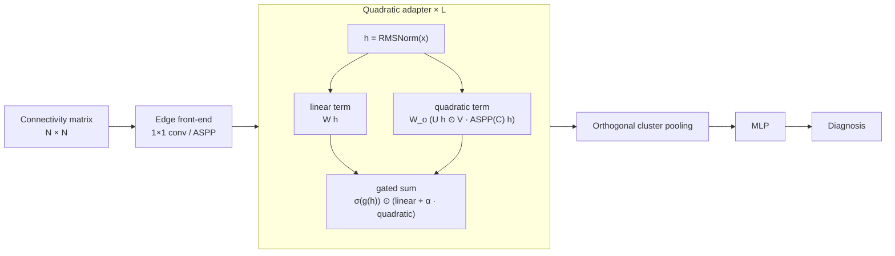

<div align="center">

# Atlas Matters: Edge Quadratics for Consistent Brain Connectivity Prediction

**EDGEQUADD** · a quadratic edge model for classifying brain functional-connectivity matrices,<br>
evaluated against ten graph and transformer baselines under one shared protocol.


</div>

---

## Overview

Brain-connectivity classifiers are usually reported on a single parcellation, yet their ranking often changes with the
atlas. EDGEQUADD operates directly on the region-by-region correlation matrix and adds a **gated, low-rank quadratic
interaction** between each region's representation and a multi-scale (ASPP-filtered) view of the connectivity. The
repository contains the model, the baselines, and a benchmark runner that trains every model with the same splits,
budget, checkpoint selection and metrics, so results are comparable across models and atlases.



## Repository layout

```
EDGEQUADD/        model (model/) and its constructor for the runner (build.py)
baselines/        GCN · GraphSAGE · GAT · GPS · BNT · BrainNetCNN · Transformer · ALTER · BQN · BioBGT
benchmark/        runner: data loading, splits, training loop, metrics, tuning, aggregation
configs/          tuned EDGEQUADD configurations and expected results (ADNI, ABIDE, PPMI)
scripts/          one-command reproduction
```

## Installation

```bash
git clone https://github.com/1999-karthik/Atlas-Matters-Edge-Quadratics-for-Consistent-Brain-Connectivity-Prediction.git
cd Atlas-Matters-Edge-Quadratics-for-Consistent-Brain-Connectivity-Prediction
pip install -r requirements.txt        # Python 3.10; tested versions are pinned
```

## Data

ADNI, ABIDE and PPMI cannot be redistributed. Request access from the providers under their data use agreements:
[ADNI](https://adni.loni.usc.edu) · [ABIDE](http://fcon_1000.projects.nitrc.org/indi/abide/) · [PPMI](https://www.ppmi-info.org).

The runner expects one preprocessed file per dataset and atlas: a NumPy dictionary with the subjects' correlation
matrices (`correlation`) and labels (`labels`), stored as

```
Datasets/<dataset>_data/<dataset>_<atlas>.npy        e.g. Datasets/adni_data/adni_schaefer100.npy
```

Use `--data_dir` (or `DATA_DIR=` for the scripts) for another location. Atlases: **AAL116, Harvard-Oxford 48,
Schaefer 100, K-means 100, Ward 100**.

## Quick start

```bash
# one model, one dataset, one seed
python benchmark/run.py --dataset adni_schaefer100 --model edgequadd --seed 42 \
    --selection val_loss --strict_determinism --tuned configs/adni/edgequadd/adni_schaefer100.json
```

Each run writes its configuration, split, metrics, predictions, training log and best checkpoint to
`runs/<model>/<dataset>/<atlas>/seed_<seed>/`.

## Reproducing the results

```bash
bash scripts/run_adni.sh schaefer100             # one atlas, five seeds
bash scripts/run_adni.sh all                     # every ADNI atlas
bash scripts/run_abide.sh all                    # every released ABIDE atlas
bash scripts/run_ppmi.sh all                     # every released PPMI atlas

python benchmark/aggregate.py --runs runs/adni_repro   # mean ± std over seeds
```

**Expected EDGEQUADD test AUC** (%, mean ± sample std over five seeds):

| Dataset | AAL116 | Harvard48 | K-means 100 | Schaefer 100 | Ward 100 |
|---|:---:|:---:|:---:|:---:|:---:|
| ADNI (2 classes) | 85.10 ± 9.66 | 85.39 ± 1.94 | 44.80 ± 8.60 | 90.69 ± 5.13 | 50.59 ± 9.14 |
| ABIDE (2 classes) | 70.25 ± 2.07 | 68.80 ± 4.28 | 47.67 ± 4.79 | 71.57 ± 4.04 | 50.59 ± 2.34 |
| PPMI (4 classes) | 56.26 ± 8.82 | 53.20 ± 4.38 | 53.14 ± 6.83 | 57.01 ± 9.83 | 51.74 ± 7.08 |

Per-seed values are in [`configs/adni`](configs/adni), [`configs/abide`](configs/abide) and [`configs/ppmi`](configs/ppmi).
Small differences can appear on other GPUs or library versions; the GPU used for each result is listed in `configs/<dataset>/summary.csv`.

## Evaluation protocol

| | |
|---|---|
| **Splits** | label-stratified 70 / 10 / 20 for seeds 42, 1042, 2042, 3042, 4042; identical for every model |
| **Training** | fixed epoch budget per configuration; same loop and loss for all models |
| **Model selection** | checkpoint chosen on the validation set only (validation loss for ADNI and ABIDE, validation AUC for PPMI) |
| **Testing** | evaluated once, with the selected checkpoint |
| **Metrics** | AUC (macro one-vs-rest for multi-class), accuracy, sensitivity, specificity |
| **Reporting** | mean ± sample standard deviation over the five seeds |

## Hyper-parameter tuning

```bash
python benchmark/tune.py --model edgequadd --dataset adni_schaefer100 --trials 200 --seed 42         # run the study
python benchmark/tune.py --model edgequadd --dataset adni_schaefer100 --trials 200 --seed 42 --export   # write best.json
```

Search uses Optuna (TPE sampler, median pruner) on the seed-42 validation split; test data are never read during tuning.
All models share the same training search space; model-specific spaces are defined in
[`benchmark/spaces.py`](benchmark/spaces.py).

## Baselines

| Model | Reference |
|---|---|
| GCN · GraphSAGE · GAT | Luo et al., NeurIPS 2024 ([tunedGNN](https://github.com/LUOyk1999/tunedGNN)) |
| GPS | Rampášek et al., NeurIPS 2022 (PyTorch Geometric `GPSConv`) |
| BNT | Kan et al., NeurIPS 2022 ([BrainNetworkTransformer](https://github.com/Wayfear/BrainNetworkTransformer)) |
| BrainNetCNN | Kawahara et al., NeuroImage 2017 |
| Graph Transformer | via BrainNetworkTransformer |
| ALTER | [yushuowiki/ALTER](https://github.com/yushuowiki/ALTER) |
| BQN | [LYWJUN/BQN-demo](https://github.com/LYWJUN/BQN-demo) |
| BioBGT | Peng et al., ICLR 2025 ([pcyyyy/BioBGT](https://github.com/pcyyyy/BioBGT)) |

All baseline methods and their original implementations are the work of their authors; please cite them. Sources and
modifications are documented in [`baselines/`](baselines). ALTER, BQN and BioBGT are adapted from repositories that
publish no license: they are included only to reproduce our comparisons, all rights remain with their authors, and we
will remove them on request.
